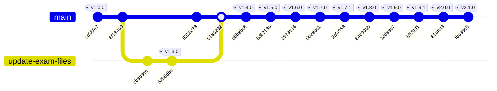

# 金融證照歷屆題庫互動測驗系統 (Exam Web)

> 專為臺灣金融證照考試量身打造的極致輕量、無須伺服器後端之單頁式（SPA）互動測驗系統。收錄 **6,620 題** 歷屆與官方標準題庫，支援跨證照（投信投顧、期貨商業務員、共同科目）自由複選抽題、關鍵字專題出題、錯題自動歸檔與 Google 帳號跨裝置雲端同步。

* 🌐 **線上測驗正式網址**：[https://renart00001-ux.github.io/exam-web/](https://renart00001-ux.github.io/exam-web/)
* 🚀 **託管與自動化部署**：GitHub Pages + GitHub Actions CI/CD
* 📊 **題庫總容量**：共 6,620 題
  - 📗 **投信投顧相關法規**：105–115 年歷屆 36 梯次共 1,800 題
  - 📙 **期貨商業務員**：105–115 年歷屆 37 梯次雙科共 3,700 題（期貨交易法規 1,850 題 ＋ 期貨交易理論與實務 1,850 題）
  - 📘 **共同科目**：113 年金融市場常識 504 題 ＋ 113 年職業道德 616 題共 1,120 題

---

## 🌟 核心功能特色

1. **跨證照、跨年度與跨科目自由複選抽題與全量出題雙模式**：
   - **🎛️ 分頁式測驗範圍選單（License Category Tabs）**：重塑選單為 4 大分頁（📗 投信投顧、📙 期貨商業務員、📘 共同科目、📌 我的錯題庫），各分頁即時呈現勾選題數徽章。
   - **⚡ 快速情境預設**：提供「⚡ 近 1 年」、「⚡ 近 3 年」、「⚡ 近 5 年」、「全選本類別」與「清空」一鍵快速勾選，並支援「近期 111–115 年」與「歷屆 105–110 年」年度折疊分組，解決選單過長難以操作的問題。
   - **雙模出題機制**：
     - **🎲 隨機抽 50 題模式**：每題 2 分，滿分 100 分，70 分及格。
     - **📚 全量出題模式**：選取的題庫每題皆出（支援 50 至 6,620 題，徹底杜絕漏題），分數採「作答正確比率 (%)」精確計算，70% 及格。
2. **🎯 關鍵字專題出題引擎**：
   - 輸入考點關鍵字（如：`開放式`、`處分`、`主管機關`、`基差`、`保證金` 等）。
   - 搭配目前勾選的測驗範圍即時檢索出題；若勾選範圍無符合題目，提供一鍵跨全題庫 6,620 題檢索出題。
3. **🚨 反向題型／否定關鍵字自動紅字粗體**：
   - 正則自動辨識「何者非、不正確、不包含、不包括、不適當、不正當、不屬於、不屬、不當、不能、不承保、不在、不可、非屬、錯誤、有誤、為非、非為、不是、不得、不符、未符」等字詞，防止審題粗心失分。
4. **📑 三段錯誤選項灰階速記**：
   - 提供「淺灰、中灰、極淺灰」三段淡化干擾選項，聚焦正確答案，大幅提高考前記憶效率。
5. **☁️ Firebase Auth 與 Cloud Firestore 跨裝置同步**：
   - 支援 Google 帳號一鍵登入，手機、平板、電腦錯題本即時雙向同步。
   - 訪客離線模式（localStorage）與會員雲端模式雙軌並行，支援 JSON 檔案備份匯入與匯出。
6. **📄 官方原始 PDF 試卷雙軌查核**：
   - 每題均附官方試題與解答 PDF（全站收錄 148 份官方 PDF），智慧切換本機離線相對路徑與 Google Drive 雲端檢視連結。
7. **📱 手機響應式面板與深色/折疊優化**：
   - 頂部控制欄支援一鍵收折，保留最大可視閱讀題幹空間。
8. **💡 考點提示與 📘 試題解析雙向擴充機制**：
   - **💡 考點提示 (Hint)**：題目出現即時可視；以常理暗示或極端詞破綻引導解題思維；僅限管理員帳號（`renart.00001@gmail.com`）具備編輯改寫權限，點選送出即刻生效。
   - **📘 試題解析 (Explanation)**：作答完畢後動態開展；A/B/C/D 四個選項逐一提供精準法規依據與錯誤破綻；開放所有登入帳號共同補充，送出改寫並留存「Last edited by [帳號] at [時間]」透明化稽核紀錄。
   - **⚡ 5,500 題專業科目提示與解析全量完工**：針對投信投顧 1,800 題與期貨商 3,700 題歷屆試題，全面預載高品質標準提示與逐選項解析，100% 達成去識別化。

---

## 📈 Git 版本控制演進圖表 (Git Process & Version Flow Chart)

> 💡 **未來同步維護規範**：專案進行重大功能更新或版本發布時，請務必在此節點同步更新 Mermaid 分支演進圖與下方版本紀錄表，並同步更新網頁端 `index.html` 之常駐時間軸。



---

## 📜 詳細版本演進歷程 (Version History Table)

| 版本 | 發布日期 | Commit Hash | 核心更新內容與重要成就 |
| :--- | :--- | :--- | :--- |
| **v2.1.0** | 2026-11-08 | `fb638e5` | 📙 **期貨商雙科 3,700 題全量納入**：完整收錄 105 年第 01 次至 115 年第 02 次歷屆共 37 梯次，「期貨交易法規」（1,850 題）與「期貨交易理論與實務」（1,850 題），全題庫規模一舉躍升至 6,620 題。<br>🔍 **100% 官方答案精準校對**：含 8 卷純圖形掃描答案卡人工切片校對與 112-03 第 14 題更正答案，全量考題答案卡 100% 精準對齊。<br>🎛️ **分頁式測驗範圍選單（License Category Tabs）**：重塑下拉選單為 4 大分頁（📗 投信投顧、📙 期貨商、📘 共同科目、📌 錯題庫），搭配「近1年 / 近3年 / 近5年 / 全選」快速情境預設與年度折疊，徹底解決選單過長問題。<br>🛡️ **100% 去識別化與標準提示解析**：全面淨化清除所有作者暱稱與水印，並為 3,700 題配備標準考點提示與四選項逐項解析（標註正確/錯誤）。 |
| **v2.0.0** | 2026-11-03 | `81afef3` | 📚 **法規題庫重大擴充（36 梯次 1,800 題）**：完整收錄 105 年 Q2～Q4、106 年 Q1～Q4、107 年 Q1～Q4、108 年 Q1～Q4、109 年 Q1～Q4、110 年 Q1～Q3 共 22 個新梯次 1,100 道法規考古題，全題庫躍升至 2,920 題。<br>🛡️ **100% 徹底去識別化**：完全淨化清除所有私人筆記、作者暱稱與水印，公開合規呈現。<br>💡 **提示與解析全量上線**：嚴格依照 `PROMPT_STANDARD.md` 生成新增 1,100 題之考點直覺提示與四選項逐項解析（標註正確/錯誤），達成 100% 覆蓋。<br>📄 **44 份官方 PDF 試題答案卡入庫**：支援單機離線與 Google Drive 雙軌即時查閱。<br>🎛️ **測驗範圍全面支援**：測驗選單動態擴增至 36 梯次自由複選與 2,920 題全量馬拉松出題。 |
| **v1.9.1** | 2026-11-01 | `8f53bf1` | 🐛 **修復 Google 登入無反應**：修正內嵌題庫之換行符號（`\n`）轉義問題，解決導致 JavaScript 中斷執行的語法錯誤，使按鈕監聽全面正常生效。<br>🔑 **強化登入相容性**：針對部分行動裝置阻擋彈跳視窗問題，新增自動轉向 `signInWithRedirect` 備援機制。 |
| **v1.9.0** | 2026-11-01 | `13d99c7` | 📌 **常駐快捷控制列**：將「立刻顯示答案」、「錯誤選項灰階」與「PDF來源選擇」移至收折按鈕下方第一行，收折狀態隨時可操作。<br>💡 **隱藏提示開關**：新增「隱藏提示」核取方塊，即時隱藏全頁考題提示，支援 `localStorage` 記憶。<br>📘 **名詞全面正名為「解析」**：統一全站為「試題解析」（如：`試題解析`、`✏️ 編輯解析`、`＋ 撰寫解析補充`）。<br>⚡ **700 題歷屆法規提示與解析全量上線**：針對 111–115 年 14 梯次共 700 題（ID 1–700），嚴格依 prompt 規範產出高品質提示與四選項解析並內嵌題庫。 |
| **v1.8.0** | 2026-11-01 | `84e90ab` | 💡 **考點提示欄位**：每題新增提示區塊，出題即見；僅限管理員 `renart.00001@gmail.com` 具備編輯改寫權限，按送出即時持久化。<br>📘 **試題詳解與編輯稽核**：答題完畢後動態展現；開放全體帳號共同編輯補充，送出改寫並留存「Last edited by [帳號] at [時間]」完整紀錄。<br>🔄 **雙軌雲端同步**：支援 `localStorage` 離線快取與 Cloud Firestore 雲端跨裝置即時雙向同步。 |
| **v1.7.1** | 2026-10-27 | `2cfa958` | 🔒 **管理員專屬版控折疊**：版控時間軸預設僅顯示頂部簡要卡片，詳細歷程僅限 `renart.00001@gmail.com` 登入後展開查閱。<br>🚨 **反向否定詞庫擴增**：新增「不正當」、「不能」自動標紅粗體，全題庫共 8 題防呆效果顯著。 |
| **v1.7.0** | 2026-10-27 | `002e0c1` | 📚 **全量出題模式**：新增「全量出題（每題皆出）」選項，徹底解決隨機抽題遺漏題目的痛點。<br>📊 **作答正確比率計分法**：全量模式即時依作答正確比率（%）精確計分（70% 及格）。<br>🎛️ **雙模即時同步**：得分單位、進度膠囊與測驗提示依模式無縫連動切換。 |
| **v1.6.0** | 2026-10-27 | `2973e14` | 🎯 **關鍵字出題引擎**：支援搭配測驗範圍輸入關鍵字出題。<br>🚨 **反向題詞庫擴充**：新增「不屬、不屬於、不當、不承保、不在、不可」紅字粗體。<br>📜 **版本控制雙端同步**：網頁端常駐視覺化 Timeline 與 README 同步建立 Git 進程圖表。 |
| **v1.5.0** | 2026-10-24 | `6d6713a` | 🚨 **審題防呆**：題目中「何者非、不正確、不包含、錯誤、不得、有誤」等負向關鍵字自動標紅加粗。 |
| **v1.4.0** | 2026-10-24 | `d5bebc6` | ☁️ **雲端同步**：整合 Firebase Auth (Google 登入) 與 Cloud Firestore，支援多端錯題智慧聯集合併與 800ms 防抖同步。 |
| **v1.3.0** | 2026-10-23 | `51a5292` (PR #1)<br>`52b5dbc` | 📚 **共同科目擴充**：納入「113年金融市場常識（504題）」與「113年職業道德（616題）」，總題數達 1,820 題，支援數字與字母雙選項對齊；加入 `parse_questions.py` 解析腳本。 |
| **v1.2.0** | 2026-10-22 | `cb9b8ee` | 🎛️ **測驗架構升級**：14 梯次自由複選抽 50 題架構、三段錯誤選項灰階速記、手機版頂部面板收折。 |
| **v1.1.0** | 2026-10-22 | `cb9b8ee` | 📌 **錯題歸檔系統**：答錯題目自動存入專屬錯題本、官方 PDF 試題與解答雙軌查核連結。 |
| **v1.0.0** | 2026-10-22 | `cc38fe7`<br>`8f134a9` | 🚀 **專案建立**：收錄 111–115 年 14 梯次法規共 700 題、隨機 50 題測驗引擎、即時作答反饋、建立 GitHub Actions 自動部署工作流。 |

---

## 📂 專案目錄架構

```text
exam-web/
├── .github/
│   └── workflows/
│       └── deploy-pages.yml   # GitHub Actions 自動部署 GitHub Pages 流程
├── downloads/                 # 歷屆試題與官方題庫原始 PDF（共 148 份）
│   ├── 10502.pdf ~ 11502a.pdf # 105-115 年投信投顧相關法規 36 梯次試卷與答案 (72份)
│   ├── futures_10501.pdf ~ futures_11502a.pdf # 105-115 年期貨商業務員 37 梯次試卷與答案 (74份)
│   ├── 金融市場常識-113.pdf   # 113 年金融市場常識題庫 (504題)
│   └── 職業道德-113.pdf       # 113 年職業道德題庫 (616題)
├── .gitignore                 # Git 忽略設定
├── batch_generate_1100.py     # 105-110 年法規 1100 題提示與解析批次並行生成工具
├── batch_generate_700.py      # 111-115 年法規 700 題提示與解析批次並行生成工具
├── deploy.sh                  # 一鍵建置儲存庫與推送腳本
├── generate_new_questions_json.py # 22 梯次新題庫結構化資料生成腳本
├── index.html                 # 測驗主程式 (SPA, 內嵌 6,620 題、分頁式範圍選單、UI 與完整互動邏輯)
├── law_1100_extras.json       # 105-110 年法規 1,100 題提示與解析結構化資料
├── law_700_extras.json        # 111-115 年法規 700 題提示與解析結構化資料
├── merge_new_questions.py     # 題庫資料與網頁應用程式全量合併腳本
├── new_1100_questions.json    # 105-110 年 22 梯次 1,100 題結構化題庫來源
├── parse_questions.py         # 題庫 PDF 智慧剖析、對齊與 JSON 生成腳本
├── prepare_downloads.py       # 官方 PDF 試題與解答去識別化正規化入庫腳本
├── PROMPT_STANDARD.md         # 考題「提示」與「解析」AI 標準生成規範與擴充手冊
├── questions.json             # 結構化題庫資料來源 (6,620 題完整資料)
└── README.md                  # 專案說明與 Git 進程版本控制同步圖表
```

---

## 🤖 考題「提示」與「解析」AI 生成規範

本系統所有題目之「考點提示」與「試題解析」皆嚴格遵守標準化 Prompt 原則生成（包含「1～2句常理暗示/破綻揪出」與「四選項各一句直擊法規破綻/立法目的」）。

👉 **完整 Prompt 範本、典範案例與新考科擴充步驟請參閱**：[PROMPT_STANDARD.md](PROMPT_STANDARD.md)
