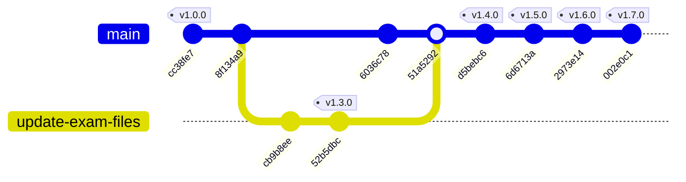

# 金融證照歷屆題庫互動測驗系統 (Exam Web)

> 專為臺灣金融證照考試量身打造的極致輕量、無須伺服器後端之單頁式（SPA）互動測驗系統。收錄 **1,820 題** 歷屆與官方標準題庫，支援跨科目自由複選抽題、關鍵字專題出題、錯題自動歸檔與 Google 帳號跨裝置雲端同步。

* 🌐 **線上測驗正式網址**：[https://renart00001-ux.github.io/exam-web/](https://renart00001-ux.github.io/exam-web/)
* 🚀 **託管與自動化部署**：GitHub Pages + GitHub Actions CI/CD
* 📊 **題庫總容量**：共 1,820 題（含 111–115 年法規歷屆 14 梯次 700 題、113 年金融市場常識 504 題、113 年職業道德 616 題）

---

## 🌟 核心功能特色

1. **跨年度與跨科目自由複選抽題與全量出題雙模式**：
   - 支援 111–115 年 14 梯次投信投顧法規試卷任選組合。
   - 支援「金融市場常識（113年題庫）」與「職業道德（113年題庫）」共同科目獨立或混合出題。
   - **雙模出題機制**：
     - **🎲 隨機抽 50 題模式**：每題 2 分，滿分 100 分，70 分及格。
     - **📚 全量出題模式**：選取的題庫每題皆出（支援 50 至 1,820 題，徹底杜絕漏題），分數採「作答正確比率 (%)」精確計算，70% 及格。
2. **🎯 關鍵字專題出題引擎**：
   - 輸入考點關鍵字（如：`開放式`、`處分`、`主管機關`、`內部控制` 等）。
   - 搭配目前勾選的測驗範圍即時檢索出題；若勾選範圍無符合題目，提供一鍵跨全題庫檢索出題。
3. **🚨 反向題型／否定關鍵字自動紅字粗體**：
   - 正則自動辨識「何者非、不正確、不包含、不包括、不適當、不屬於、不屬、不當、不承保、不在、不可、非屬、錯誤、有誤、為非、非為、不是、不得、不符、未符」等字詞，防止審題粗心失分。
4. **📑 三段錯誤選項灰階速記**：
   - 提供「淺灰、中灰、極淺灰」三段淡化干擾選項，聚焦正確答案，大幅提高考前記憶效率。
5. **☁️ Firebase Auth 與 Cloud Firestore 跨裝置同步**：
   - 支援 Google 帳號一鍵登入，手機、平板、電腦錯題本即時雙向同步。
   - 訪客離線模式（localStorage）與會員雲端模式雙軌並行，支援 JSON 檔案備份匯入與匯出。
6. **📄 官方原始 PDF 試卷雙軌查核**：
   - 每題均附官方試題與解答 PDF，智慧切換本機離線相對路徑與 Google Drive 雲端檢視連結。
7. **📱 手機響應式面板與深色/折疊優化**：
   - 頂部控制欄支援一鍵收折，保留最大可視閱讀題幹空間。

---

## 📈 Git 版本控制演進圖表 (Git Process & Version Flow Chart)

> 💡 **未來同步維護規範**：專案進行重大功能更新或版本發布時，請務必在此節點同步更新 Mermaid 分支演進圖與下方版本紀錄表，並同步更新網頁端 `index.html` 之常駐時間軸。



---

## 📜 詳細版本演進歷程 (Version History Table)

| 版本 | 發布日期 | Commit Hash | 核心更新內容與重要成就 |
| :--- | :--- | :--- | :--- |
| **v1.7.0** | 2026-10-27 | `002e0c1` | 📚 **全量出題模式**：新增「全量出題（每題皆出）」選項，徹底解決隨機抽題遺漏題目的痛點。<br>📊 **作答正確比率計分法**：全量模式即時依作答正確比率（%）精確計分（70% 及格）。<br>🎛️ **雙模即時同步**：得分單位、進度膠囊與測驗提示依模式無縫連動切換。 |
| **v1.6.0** | 2026-10-27 | `2973e14` | 🎯 **關鍵字出題引擎**：支援搭配測驗範圍輸入關鍵字出題。<br>🚨 **反向題詞庫擴充**：新增「不屬、不屬於、不當、不承保、不在、不可」紅字粗體。<br>📜 **版本控制雙端同步**：網頁端常駐視覺化 Timeline 與 README 同步建立 Git 進程圖表。 |
| **v1.5.0** | 2026-10-24 | `6d6713a` | 🚨 **審題防呆**：題目中「何者非、不正確、不包含、錯誤、不得、有誤」等負向關鍵字自動標紅加粗。 |
| **v1.4.0** | 2026-10-24 | `d5bebc6` | ☁️ **雲端同步**：整合 Firebase Auth (Google 登入) 與 Cloud Firestore，支援多端錯題智慧聯集合併與 800ms 防抖同步。 |
| **v1.3.0** | 2026-10-23 | `51a5292` (PR #1)<br>`52b5dbc` | 📚 **共同科目擴充**：納入「113年金融市場常識（504題）」與「113年職業道德（616題）」，總題數達 1,820 題，支援數字與字母雙選項對齊；加入 `parse_questions.py` 解析腳本。 |
| **v1.2.0** | 2026-10-22 | `cb9b8ee` | 🎛️ **測驗架構升級**：14 梯次自由複選抽 50 題架構、三段錯誤選項灰階速記、手機版頂部面板收折。 |
| **v1.1.0** | 2026-10-22 | `cb9b8ee` | 📌 **錯題歸檔系統**：答錯題目自動存入專屬錯題本、官方 PDF 試題與解答雙軌查核連結。 |
| **v1.0.0** | 2026-10-22 | `cc38fe7`<br>`8f134a9` | 🚀 **專案建立**：收錄 111–115 年 14 梯次法規共 700 題、隨機 50 題測驗引擎、即時作答反饋、建立 GitHub Actions 自動部署工作流。 |

---

## 📂 專案目錄架構

```text
exam-web/
├── .github/
│   └── workflows/
│       └── deploy-pages.yml   # GitHub Actions 自動部署 GitHub Pages 流程
├── downloads/                 # 歷屆試題與官方題庫原始 PDF（共 30 份）
│   ├── 11101.pdf ~ 11502a.pdf # 111-115 年投信投顧相關法規 14 梯次試卷與答案
│   ├── 金融市場常識-113.pdf   # 113 年金融市場常識題庫 (504題)
│   └── 職業道德-113.pdf       # 113 年職業道德題庫 (616題)
├── .gitignore                 # Git 忽略設定
├── deploy.sh                  # 一鍵建置儲存庫與推送腳本
├── index.html                 # 測驗主程式 (SPA, 內嵌 1,820 題、UI 與完整互動邏輯)
├── parse_questions.py         # 題庫 PDF 智慧剖析、對齊與 JSON 生成腳本
├── questions.json             # 結構化題庫資料來源 (1,820 題完整資料)
└── README.md                  # 專案說明與 Git 進程版本控制同步圖表
```
